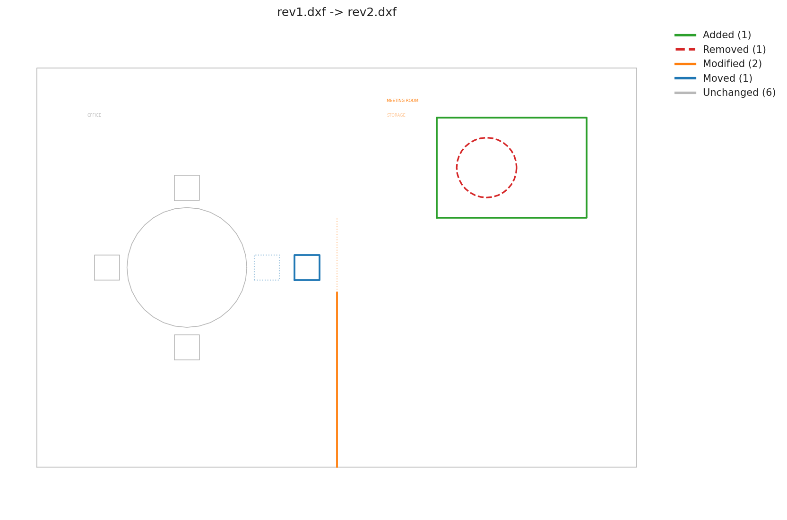

# dxf-diff

**`git diff` for AutoCAD drawings.** Compare two revisions of a DXF/DWG file and see exactly what was **added**, **removed**, **modified** or **moved**: as an overlay image, an HTML report, JSON, or a Markdown comment on your pull request.



> Commercial CAD suites have "DWG Compare". Open-source projects, CI pipelines and people without an AutoCAD licence have nothing. `dxf-diff` fills that gap.

## Features

- **Smart matching**, not just "did the bytes change":
  - `unchanged`: same geometry and properties
  - `modified`: same entity (by handle, or same geometry) with a different layer, color, text, or shape
  - `moved`: same shape at another position (reports the offset)
  - `added` / `removed`
- Ignores noise: line direction, `-0.0`, floating-point jitter (`--precision`).
- Supports LINE, CIRCLE, ARC, ELLIPSE, LWPOLYLINE, SPLINE, TEXT, MTEXT, INSERT (blocks + attributes), POINT, HATCH, DIMENSION, plus a generic fallback for everything else.
- Output: **PNG/SVG/PDF overlay**, **self-contained HTML report**, **JSON**, **Markdown**.
- **DWG** input through the free [ODA File Converter](https://www.opendesign.com/guestfiles/oda_file_converter).
- **GitHub Action** that posts the diff on every pull request that touches a `.dxf`.
- Exit code `1` when the drawings differ, like `diff`, so it works in scripts.

## Install

```bash
pip install dxf-diff
```

## Usage

```bash
dxf-diff old.dxf new.dxf                 # text summary
dxf-diff old.dxf new.dxf -o diff.png     # overlay image
dxf-diff old.dxf new.dxf --html report.html --json report.json
dxf-diff old.dwg new.dwg -o diff.svg     # DWG (needs ODA File Converter)
```

```
dxf-diff: 2 added, 1 removed, 1 modified, 1 moved, 14 unchanged
  + LINE on layer 'WALL'
  + TEXT "MEETING ROOM" on layer '0'
  - CIRCLE on layer 'FURN'
  ~ LWPOLYLINE on layer 'WALL' - layer: FURN -> WALL
  > INSERT <CHAIR> on layer 'FURN' - moved by (1.5, 0)
```

| Option | Meaning |
|---|---|
| `-o FILE` | overlay image, format from the suffix (`.png`, `.svg`, `.pdf`) |
| `--html FILE` | self-contained HTML report |
| `--json FILE` | JSON report (`-` for stdout) |
| `--markdown FILE` | Markdown summary for PR comments |
| `--precision N` | decimals used when comparing coordinates (default 4) |
| `--ignore-layer L` | skip a layer (repeatable) |
| `--no-handles` | do not match by entity handle |
| `--no-moves` | report moves as remove + add |
| `--no-fuzzy` | do not pair overlapping entities of the same type and layer |
| `--hide-unchanged` | draw only the changes |
| `--dark` | dark background |
| `--exit-zero` | always exit 0 |

### Python API

```python
from dxfdiff import diff
from dxfdiff.render import render

result = diff("rev1.dxf", "rev2.dxf", precision=3)
print(result.summary)          # {'added': 2, 'removed': 1, ...}
for change in result.changes:
    print(change.kind, change.type, change.details)
render(result, "diff.png")
```

## GitHub Action

```yaml
# .github/workflows/cad-diff.yml
name: CAD diff
on: pull_request
permissions:
  contents: read
  pull-requests: write
jobs:
  diff:
    runs-on: ubuntu-latest
    steps:
      - uses: actions/checkout@v4
        with: { fetch-depth: 0 }
      - uses: OWNER/dxf-diff@v0
```

For every changed `.dxf` file, the action compares the base and head versions, uploads the overlay images as an artifact, and posts a summary comment on the PR.

## How matching works

1. **Exact**: identical geometry signature and properties gives `unchanged`.
2. **Same geometry, other properties**: `modified` (for example a layer or color change).
3. **Same handle** (AutoCAD keeps handles stable across saves): `modified` with `geometry: true`.
4. **Same shape, other position** (translation-invariant signature): `moved`.
5. **Fuzzy**: same type and layer with overlapping bounding boxes (a wall that got shorter, a label that was re-worded): `modified`.
6. Whatever is left becomes `added` / `removed`.

## Development

```bash
pip install -e ".[dev]"
python examples/make_example.py   # regenerates examples/diff.png
pytest
```

Contributions welcome, especially support for more entity types and for paper-space layouts.

## License

MIT
